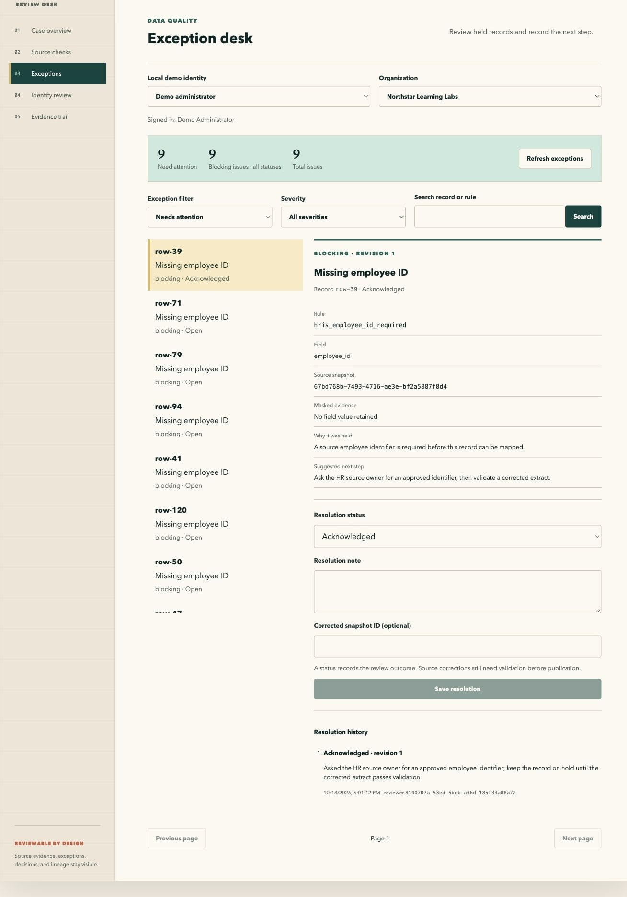

# Connected Exception Desk

## Remembered filters

Status, severity, and sort order are remembered in this browser tab separately for each identity and organization. Returning to the desk or reloading restores them; **Reset filters** restores Needs attention, All severities, and Oldest first, and clears the current search. Malformed preferences or blocked storage fall back safely to defaults. Server permissions are checked on every request; a stored preference grants no access.

Only those three menu selections are stored in session storage. Search text, review notes, record selections, page offsets, and snapshot identifiers are not stored. Browser tab/session restoration behavior varies, so do not treat closing a tab as a secure data-erasure mechanism. The public static preview does not use these connected-desk preferences.

## Results and pages

The desk displays the filtered matching total, visible result range, and page count. **Next page** is disabled on the last page, including when it contains exactly 20 issues. If a resolution removes the last issue on the current filtered page, the desk returns to the last valid page. The workload totals above the filters describe the whole organization; the matching total describes the current filters and search.

The desk uses the additive `GET /api/v1/quarantine/page` endpoint. Its response contains `items`, `total`, `limit`, and the effective `offset`, with the same filters, sorting, organization scope, and `validation:write` permission as the original list route. An out-of-range offset is clamped to the last valid page (zero for an empty result). The original `GET /api/v1/quarantine` still returns a plain list for existing clients. Counts and rows reflect database reads; concurrent changes can affect later refreshes.

## Queue order

Use **Sort order** to review oldest issues first, newest issues first, or highest severity first. Severity order is blocking, error, then warning; equal-severity issues are ordered oldest first. Equal timestamps use the issue ID as a stable tie-breaker. Sorting applies to the full filtered queue on the server, not just the visible page. API clients can add `sort=oldest`, `sort=newest`, or `sort=severity` to `GET /api/v1/quarantine`; omitting it retains the oldest-first default.

## Unfinished resolutions

Changing records, filters, pages, identity, organization, or workspace sections prompts before discarding an unfinished resolution. Cancel keeps the current note and selection. A pending save must finish before leaving. Refreshing a stale exception also requires confirmation before discarding the draft. Queue background refresh is disabled so window focus cannot silently replace an edited record; use **Refresh exceptions** to load current data.

Supported browsers also warn before closing or reloading the page after editing. This browser warning is not guaranteed on every device, especially when a mobile app is forcibly closed. Draft notes are kept only in memory, not browser storage, and are saved to the server only after **Save resolution** succeeds.

The local Exceptions screen reads saved validation issues from the selected organization's database. It shows the affected record key, rule, severity, masked evidence, source snapshot, and suggested next step.

## Run and review

1. Back up an existing control database, install the committed dependencies, and run `uv run alembic upgrade head`.
2. Run `make demo`. The HRIS source validation creates nine missing-identifier issues from the small synthetic fixture before mapping; other validations can add their own issues. Repeated demo runs append validation evidence.
3. Start `make api` and `make ui` in separate terminals. Open the reviewer desk at `http://localhost:5173` and select **Exceptions**.
4. Select a demo identity and an accessible organization. **Needs attention** includes open and acknowledged issues. Filter by severity or status, search by record key or rule, and page through the results.
5. Inspect an issue. Choose a resolution status, enter a reason, and optionally link a corrected snapshot for the same source object in the same organization. Save the resolution.
6. Refresh and inspect the resolution history. To find a closed or waived issue, switch to **All statuses** or its specific status. Reopening requires a new note and preserves earlier resolutions.

The queue, summary, history, and resolution endpoints require `validation:write`. The demo viewer cannot use the desk. Changing organizations or identities isolates the displayed queue and history.

## History and concurrent review

Every successful resolution appends its status, note, authenticated reviewer, timestamp, optional corrected snapshot, and sequential revision. The resolution, current issue status, and audit event commit together. An audit failure rolls back the resolution.

Saves require the issue's `expected_revision`. If another reviewer saves first, the API returns HTTP 409. Refresh the exception, inspect the latest history, and enter a new note before saving again.

Migration `20261018_0006` imports the latest note retained by v0.50 as revision 1, marked as imported. Earlier versions did not retain every resolution; this migration does not invent missing history. Unreviewed issues start at revision 0. Downgrade is refused once new resolutions exist, to avoid discarding their history; recovery should use the pre-upgrade backup.

## Status meaning

Statuses record review outcomes. A waiver or closure does not change the original source file, repair a mapping, rerun validation, or authorize publication. Validate a corrected extract through the existing processing workflow before using its outputs. Masked evidence remains masked; review notes should avoid personal information.

The public GitHub Pages case file continues to show synthetic exception examples. Connected resolutions are saved by the local API.
