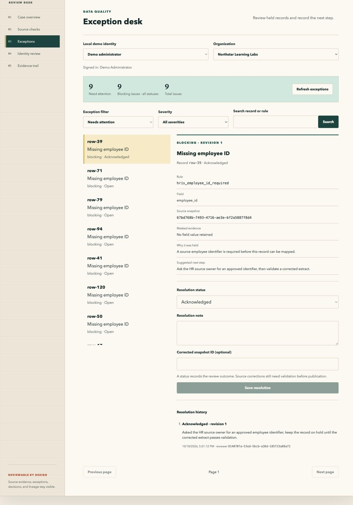

# Connected Exception Desk

The local Exceptions screen reads saved validation issues from the selected organization's database. It shows the affected record key, rule, severity, masked evidence, source snapshot, and suggested next step.

## Run and review

1. Back up an existing control database, install the committed dependencies, and run `uv run alembic upgrade head`.
2. Run `make demo`. The HRIS source validation creates nine missing-identifier issues from the small synthetic fixture before mapping; other validations can add their own issues. Repeated demo runs append validation evidence.
3. Start `make api` and `make ui` in separate terminals. Open the reviewer desk at `http://localhost:5173` and select **Exceptions**.
4. Select a demo identity and an accessible organization. **Needs attention** includes open and acknowledged issues. Filter by severity or status, search by record key or rule, and page through the results.
5. Inspect an issue. Choose a resolution status, enter a reason, and optionally link a corrected snapshot for the same source object in the same organization. Save the resolution.
6. Refresh and inspect the resolution history. To find a closed or waived issue, switch to **All statuses** or its specific status. Reopening requires a new note and preserves earlier resolutions.

The queue, summary, history, and resolution endpoints require `validation:write`. The demo viewer cannot use the desk. Changing organizations or identities isolates the displayed queue and history.

## History and concurrent review

Every successful resolution appends its status, note, authenticated reviewer, timestamp, optional corrected snapshot, and sequential revision. The resolution, current issue status, and audit event commit together. An audit failure rolls back the resolution.

Saves require the issue's `expected_revision`. If another reviewer saves first, the API returns HTTP 409. Refresh the exception, inspect the latest history, and enter a new note before saving again.

Migration `20261018_0006` imports the latest note retained by v0.50 as revision 1, marked as imported. Earlier versions did not retain every resolution; this migration does not invent missing history. Unreviewed issues start at revision 0. Downgrade is refused once new resolutions exist, to avoid discarding their history; recovery should use the pre-upgrade backup.

## Status meaning

Statuses record review outcomes. A waiver or closure does not change the original source file, repair a mapping, rerun validation, or authorize publication. Validate a corrected extract through the existing processing workflow before using its outputs. Masked evidence remains masked; review notes should avoid personal information.

The public GitHub Pages case file continues to show synthetic exception examples. Connected resolutions are saved by the local API.
